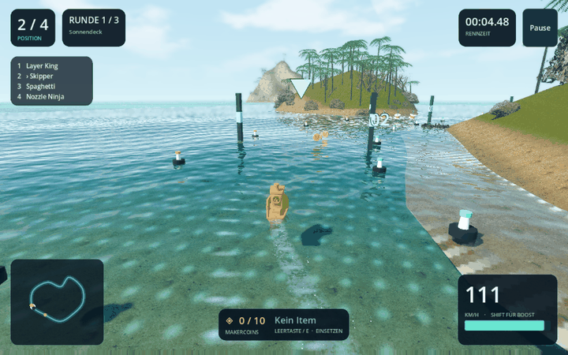

# Benchy Racers

Installierbares 3D-Wasser-Rennspiel für Windows mit dem originalen #3DBenchy. Aktueller Stand: **0.4.1**, spielbarer Prototyp.

## Spielen

Windows-Installer und portable ZIP stehen unter [Releases](../../releases). Für das fertige Spiel muss Godot nicht installiert werden. Windows 10/11, 64 Bit; eine aktuelle Grafikkarte wird empfohlen. Bei Grafikproblemen den Kompatibilitätsstart mit OpenGL verwenden.

- Drei Strecken: Sonnendeck, Frostfjord und Neonhafen.
- Online-Rennen über direkte Host-Client-Verbindung, bis zu acht Spieler; Bots füllen freie Plätze bis vier Fahrer.
- Zehn Filamentfarben, Galaxy-Glitzer, Auftrieb an vier Rumpfpunkten, Kollisionen, Boost und Items.
- Makercoins und Filamentrollen zum Einsammeln.
- Grafikmenü, Vollbild, Gamepad und drei eigene elektronische Musikstücke.

**Steuerung:** W/A/S/D oder Pfeiltasten, Shift für Boost, Leertaste/E für Items, R zum Zurücksetzen und Esc für das Menü.

Für Online-Rennen hostet ein Spieler und die anderen verbinden sich über seine IP. UDP-Port 27844 muss erreichbar sein. UPnP wird versucht; bei CGNAT kann ein gemeinsames virtuelles Netzwerk nötig sein. Es gibt noch kein Matchmaking oder Relay. Details: [Spielanleitung](docs/LIESMICH.txt).

## Vorschau aus dem Spiel

Die erhöhte Kamera in dieser Aufnahme dient zur Kontrolle der Heckspur.



## Projekt öffnen und exportieren

1. Godot **4.6** installieren.
2. `work/game/project.godot` importieren und öffnen. Godot erzeugt den Importcache selbst.
3. Mit F6/F5 oder dem Play-Knopf starten.
4. Für einen Windows-Export die zu Godot 4.6 passenden Exportvorlagen installieren und das vorhandene Preset **Windows Desktop** verwenden.

Das Projekt nutzt GDScript und Forward+. Die Modelle, Texturen und Musik für alle drei Karten sind enthalten. Die Skripte unter `work/tools` dienen zur Asset-Aufbereitung und zum Windows-Installer. Für diese Werkzeuge sind je nach Aufgabe Python mit Pillow/Numpy/Scipy, Blender und der Windows-C#-Compiler erforderlich. Zum Spielen oder Bearbeiten des bestehenden Godot-Projekts braucht man diese Werkzeuge nicht.

## Prüfungen

Die spielinterne Prüfroutine kann über zusätzliche Startargumente aufgerufen werden:

```text
godot --headless --path work/game -- --test --solo --wake-check --mechanics --graphics-check --duration=3
```

Der aktuelle Stand wurde als Windows-Spiel ausgeführt. Die Prüfungen umfassen Auftrieb, Kollisionen, Items, Grafikoptionen und die Ausrichtung sowie das Ausklingen der Heckspur. Eine direkte Verbindung zwischen zwei lokalen Spielinstanzen wurde geprüft. Internetverbindungen zwischen unterschiedlichen Anschlüssen sind nicht durchgängig getestet.

## Stand und Credits

Dies ist ein Arcade-Prototyp. Die Grafik erreicht noch nicht das angestrebte fotorealistische Niveau. Strecken, Balance und Online-Funktionen werden weiterentwickelt.

- Original #3DBenchy: Daniel Norée / Creative Tools, [CC0](https://www.3dbenchy.com/license/).
- Naturtexturen und gescannte Modelle: [Poly Haven](https://polyhaven.com), CC0. Einzelquellen stehen in der Spielanleitung und `work/game/assets/scans/credits.json`.
- Godot Engine: MIT; [Lizenz](docs/GODOT-LICENSE.txt) und [Drittanbieterhinweise](docs/GODOT-THIRDPARTY.txt).
- Filamentnamen sind Marken der jeweiligen Hersteller; das Spiel ist kein offizielles Produkt dieser Marken.

Für den eigenen Spielcode wurde bisher keine separate Open-Source-Lizenz festgelegt. Die genannten Lizenzen der eingebundenen Drittanbieter gelten unabhängig davon.
